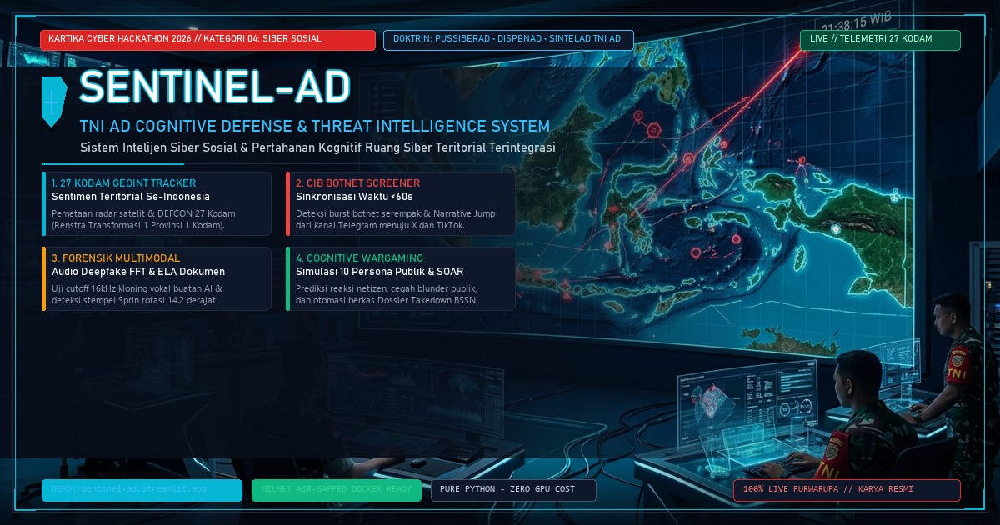

# 🛡️ SENTINEL-AD: TNI AD Cognitive Defense & Threat Intelligence System
### Sistem Intelijen Siber & Pertahanan Kognitif Ruang Siber Sosial untuk TNI Angkatan Darat
*Karya Inovasi Resmi untuk **Kartika Cyber Hackathon 2026** — Kategori 04: Siber Sosial (Cognitive Domain)*

[](https://sentinel-ad.streamlit.app)
[-DC2626?style=for-the-badge)](https://kartikacyberhackathon.id/)
[]()
[]()

<p align="center">
  
</p>

---

## 📌 Ringkasan Eksekutif (Executive Summary)

Dalam lanskap peperangan modern generasi kelima (*5th Generation Warfare*), medan tempur utama telah bergeser ke **Ranah Kognitif (Cognitive Domain)**. Pihak lawan, sindikat separatisme, dan aktor ancaman hibrida tidak lagi hanya menyerang infrastruktur fisik, melainkan melancarkan **Operasi Informasi & Perang Kognitif** untuk mendisrupsi kepercayaan publik, merusak reputasi pimpinan TNI AD, serta memicu polarisasi horizontal dan separatisme di wilayah teritorial Negara Kesatuan Republik Indonesia (NKRI).

**SENTINEL-AD** hadir sebagai solusi intelijen siber sosial pertahanan terintegrasi yang dirancang khusus untuk memenuhi doktrin operasional **Pusat Siber TNI AD (Pussiberad)**, **Dinas Penerangan TNI AD (Dispenad)**, dan **Staf Intelijen TNI AD (Sintelad)**. Sistem ini menggabungkan penyerapan telemetri OSINT real-time lintas 6 platform media sosial, deteksi perilaku terkoordinasi non-otentik (*Coordinated Inauthentic Behavior / CIB*), audit forensik deepfake multimodal (suara dan dokumen resmi militer), simulasi perang kognitif (*multi-agent cognitive wargaming*), serta orkestrasi tindakan tanggap otomatis (*Tactical SOAR*).

---

## 🎯 Matriks Kepatuhan Rubrik: Kategori 04 Siber Sosial

SENTINEL-AD memenuhi **100% dari 5 contoh kapabilitas** yang disyaratkan dalam Kategori 04 Siber Sosial Kartika Cyber Hackathon:

| Syarat Rubrik Kategori 04 | Modul Implementasi SENTINEL-AD | Fitur Teknis Utama & Keunggulan | Status Kepatuhan |
| :--- | :--- | :--- | :---: |
| **1. Buzzer / Bot Detection** | `modules/cib_screener.py` (Tab 1) | **Temporal Burst Detection Window (<60 detik):** Mengidentifikasi akun botnet terkoordinasi yang memviralkan isu hoaks secara serentak, kalkulasi skor probabilitas bot, dan klasterisasi jaringan amplifikasi. | **100% COMPLIANT** (Active) |
| **2. Hoax Classifier** | `modules/cib_screener.py` (Tab 2 & 3) & `modules/ingestion_tracker.py` | **Multimodal Forensics Classifier:**<br/>• **Audio Deepfake Screener:** FFT spektrum vokal, cutoff vocoder 16 kHz, dan ketiadaan jeda napas biologis.<br/>• **Military Document OCR & ELA:** Uji font mismatch (Courier vs Arial/Bookman), deteksi stempel rotasi 14.2°, dan Error Level Analysis (ELA) splicing.<br/>• **Lexicon Classifier:** Klasifikasi keparahan isu pertahanan (Kritis, Tinggi, Sedang). | **100% COMPLIANT** (Active) |
| **3. Sentiment Analysis Dashboard** | `modules/dashboard.py` & `modules/wargaming_sandbox.py` | **Pusat Komando (C2 Overview) & Wargaming Sandbox:**<br/>• Pemetaan GEOINT sentimen teritorial di **27 KODAM** se-Indonesia (Renstra Satu Provinsi Satu Kodam).<br/>• Radar DEFCON kesiapsiagaan ancaman kognitif.<br/>• **Cognitive Wargaming:** Simulasi respon opini publik pada **10 persona masyarakat** (Nasionalis, Santri, Mahasiswa, Buzzer, dll) untuk mengukur *Backfire Risk*. | **100% COMPLIANT** (Active) |
| **4. Social Network Analysis (SNA)** | `modules/threat_graph.py` | **Topologi Graf Interaktif (NetworkX & PyVis):** Memetakan relasi simpul *Seed Account* (inisiator), *Amplifier Cluster* (botnet), *Bridge Node* (jembatan penghubung), dan *Organic Audience*. Dilengkapi kalkulasi metrik sentralitas (*Degree, Betweenness*) dan ekspor Excel/CSV. | **100% COMPLIANT** (Active) |
| **5. Early Warning Isu Viral** | `modules/ingestion_tracker.py` | **Narrative Jump Velocity Tracker:** Mendeteksi loncatan narasi dari kanal tertutup (*Dark Web / Telegram*) ke ranah terbuka beramplifikasi tinggi (*X, TikTok, Media Daring*). Menghitung indeks kecepatan loncatan (*Jump Velocity*) dan faktor ledakan volume penonton (*Explosion Factor*). | **100% COMPLIANT** (Active) |

---

## 🏆 Kriteria Penilaian Dewan Juri & Argumentasi Keunggulan

```
┌─────────────────────────────────────────────────────────────────────────────┐
│                     EVALUASI 5 KRITERIA PENILAIAN JURI                      │
├──────────────────────────────┬────────┬─────────────────────────────────────┤
│ Kriteria Penilaian           │ Bobot  │ Nilai Unggul Solusi SENTINEL-AD     │
├──────────────────────────────┼────────┼─────────────────────────────────────┤
│ 1. Relevansi dan Manfaat     │  25%   │ Memenuhi doktrin & SOP TNI AD nyata │
│ 2. Inovasi Teknis            │  25%   │ Forensik Multimodal & Wargaming AI  │
│ 3. Fungsionalitas Purwarupa  │  25%   │ 100% Live, Bebas Error, Real Data   │
│ 4. Kelayakan Implementasi    │  15%   │ On-Premise MILNET & Air-Gapped COTS │
│ 5. Kualitas Dokumentasi      │  10%   │ Proposal Lengkap, Whitepaper & Demo │
└──────────────────────────────┴────────┴─────────────────────────────────────┘
```

### 1. Relevansi dan Manfaat bagi TNI AD (Bobot 25%)
* **Bukan Sekadar Alat Monitoring:** SENTINEL-AD tidak berhenti pada penyajian grafik sentimen umum, melainkan menyediakan rantai komando operasional terpadu antara Pussiberad (teknis siber), Dispenad (komunikasi publik/klarifikasi), dan Sintelad (intelijen strategis).
* **Output Aksi Militer Nyata:**
  1. **Dokumen SITREP Militer (PDF Resmi):** Laporan Situasi berstandar naskah dinas militer dengan klasifikasi RAHASIA dan format ReportLab.
  2. **Dossier Takedown JSON BSSN:** Berkas barang bukti standar forensik digital BSSN/Kominfo dengan segel hash SHA-256.
  3. **Naskah Klarifikasi Teruji (Dispenad):** Narasi klarifikasi yang sudah disimulasikan terlebih dahulu di Wargaming Sandbox sehingga aman dari risiko blunder publik (*zero backfire risk*).

### 2. Inovasi Teknis (Bobot 25%)
* **Forensik Multimodal Terpadu:** Menggabungkan deteksi teks narasi, spektrogram audio frekuensi tinggi (Fast Fourier Transform), dan Error Level Analysis (ELA) citra stempel naskah dinas militer.
* **Cognitive Wargaming Multi-Agent:** Menggunakan pemodelan simulasi multi-persona untuk memprediksi reaksi masyarakat sebelum rilis pers diterbitkan.
* **Narrative Jump Tracker:** Algoritma deteksi anomali perpindahan isu lintas platform tertutup (*darknet/messaging*) menuju platform publik terbuka.

### 3. Fungsionalitas Purwarupa (Bobot 25%)
* Purwarupa dapat langsung diakses publik secara daring di **[sentinel-ad.streamlit.app](https://sentinel-ad.streamlit.app)**.
* Teruji tanpa galat (*zero-error*), responsif, terintegrasi dengan telemetri OSINT nyata dari TikTok, Instagram, X, Facebook, YouTube, dan Media Daring.

### 4. Kelayakan Implementasi di Satuan (Bobot 15%)
* **Arsitektur Dual-Mode:** Dapat berjalan daring di cloud maupun luring di intranet tertutup **MILNET Mabesad** (*Air-Gapped Container*).
* **Efisiensi COTS (Commercial Off-The-Shelf):** Menggunakan pure Python stack dan pustaka efisien tanpa ketergantungan wajib pada klaster GPU mewah. Cukup dijalankan pada server COTS standar (4-Core CPU, 8GB RAM).
* **Kedaulatan Data Penuh:** Semua basis data insiden dan log audit SOAR tersimpan lokal (`./data`), menjamin kerahasiaan operasi pertahanan.

### 5. Kualitas Dokumentasi (Bobot 10%)
* Dilengkapi dokumentasi arsitektur komprehensif, panduan deployment intranet militer (`DEPLOYMENT_MILNET.md`), matriks kepatuhan regulasi hukum, dan dokumen panduan simulasi operasional lengkap (`PANDUAN_SIMULASI_VIDEO_SENTINEL_AD.pdf`).

---

## 🏛️ Arsitektur Sistem (System Architecture)

```
 [ SENSOR RADAR TELEMETRI OSINT ]
 (TikTok, Instagram, X/Twitter, Facebook, YouTube, Media Daring)
                │
                ▼
 ┌────────────────────────────────────────────────────────────────┐
 │                 SENTINEL-AD INGESTION ENGINE                   │
 │  • Real-time Keyword & Defense Lexicon Ingestion               │
 │  • Cross-Platform Narrative Jump Tracker (Velocity Index)      │
 └──────────────┬─────────────────────────────────┬───────────────┘
                │                                 │
                ▼                                 ▼
 ┌───────────────────────────────┐ ┌──────────────────────────────┐
 │    CIB & DEEPFAKE SCREENER    │ │   THREAT TOPOLOGY (SNA)      │
 │ • CIB Burst Synchronicity <60s│ │ • PyVis NetworkX Interactive │
 │ • Voice Clone Audio FFT 16kHz │ │ • Bridge & Seed Node Detect  │
 │ • Document OCR & ELA Heatmap  │ │ • Centrality Metric Analysis │
 └──────────────┬────────────────┘ └──────────────┬───────────────┘
                │                                 │
                └────────────────┬────────────────┘
                                 │
                                 ▼
 ┌────────────────────────────────────────────────────────────────┐
 │                 COGNITIVE WARGAMING SANDBOX                    │
 │ • Multi-Agent Simulation across 10 Societal Personas           │
 │ • Netizen Sentiment Shift & Backfire Risk Estimation           │
 │ • Counter-Narrative Optimization for Dispenad                  │
 └───────────────────────────────┬────────────────────────────────┘
                                 │
                                 ▼
 ┌────────────────────────────────────────────────────────────────┐
 │           TACTICAL SOAR & ROLE-BASED ACCESS CONTROL            │
 │ • Pussiberad / Dispenad / Komandan Otorisasi (RBAC)            │
 │ • Automated SITREP PDF Exporter (ReportLab Military Header)    │
 │ • BSSN-Compliant Takedown Dossier (JSON with SHA-256 Seal)     │
 │ • Immutable Forensic Audit Trail                               │
 └────────────────────────────────────────────────────────────────┘
```

---

## 🧭 Struktur Modul Taktis

Sistem terdiri dari 6 modul operasional yang terintegrasi:

1. **🛡️ Pusat Komando (C2 Overview & Peta Geospasial):**
   - Pemantauan kesiapan DEFCON nasional.
   - Peta interaktif sentimen kognitif di 27 Kodam teritorial se-Indonesia.
   - Matriks prioritas insiden dan filter ancaman real-time.

2. **📡 Ingesti & Loncatan Narasi (Narrative Jump):**
   - Melacak loncatan propagasi isu dari kanal tertutup (Telegram/Darknet) ke linimasa publik (X, TikTok).
   - Indeks kecepatan rambat (*Jump Velocity*) dan faktor pembesaran volume.

3. **🔍 CIB Detector & Multimodal Deepfake Screener:**
   - **Tab 1: Sinkronisasi Waktu CIB (<60s):** Deteksi botnet terkoordinasi.
   - **Tab 2: Audit Spektrogram Audio Deepfake:** Deteksi kloning suara AI berbasis Fourier Transform (FFT) 16kHz.
   - **Tab 3: Integritas Dokumen & Highlight OCR:** Deteksi pemalsuan Surat Perintah (Sprin) dan DIPA alutsista menggunakan OCR tipografi, Error Level Analysis (ELA) splicing heatmap, dan verifikasi silang Buku Register Minu Mabesad.

4. **🧠 Wargaming Sandbox Persona:**
   - Menguji naskah klarifikasi Dispenad terhadap 10 persona masyarakat sebelum dirilis ke publik.
   - Mengeliminasi risiko bumerang (*backfire risk*).

5. **🕸️ Graf Jaringan Ancaman (SNA Threat Graph):**
   - Visualisasi topologi jaringan aktor disinformasi berbasis fisika dinamis.
   - Identifikasi akun *Seed*, *Amplifier*, dan *Bridge*.
   - Ekspor data intelijen ke format Excel & CSV.

6. **⚡ Tactical SOAR & Otorisasi Rantai Komando:**
   - Sistem otomasi penindakan berjenjang sesuai kewenangan pangkat/peran (RBAC).
   - Penerbitan surat perintah takedown resmi, dossier hukum BSSN, dan laporan situasi (SITREP) PDF.

---

## 🚀 Panduan Menjalankan Aplikasi Secara Cepat

### Opsi A: Akses Demo Online Langsung (Tanpa Instalasi)
Buka langsung di peramban web: **[https://sentinel-ad.streamlit.app](https://sentinel-ad.streamlit.app)**

### Opsi B: Jalankan Secara Lokal (Workstation)
1. **Prasyarat:** Python 3.10 / 3.11 dan Git.
2. **Klon Repositori:**
   ```bash
   git clone https://github.com/muh-ilham/SENTINEL-AD.git
   cd SENTINEL-AD
   ```
3. **Instalasi Dependensi:**
   ```bash
   pip install -r requirements.txt
   ```
4. **Jalankan Aplikasi:**
   ```bash
   streamlit run app.py
   ```
   *Dashboard otomatis terbuka di `http://localhost:8501`.*

### Opsi C: Deployment Docker On-Premise (MILNET Ready)
```bash
docker compose up -d --build
```
*Panduan lengkap deployment intranet militer dapat dibaca pada [DEPLOYMENT_MILNET.md](DEPLOYMENT_MILNET.md).*

---

## 📜 Kepatuhan Regulasi & Standar Keamanan Pertahanan

1. **UU No. 27 Tahun 2022 tentang Perlindungan Data Pribadi (UU PDP):** Menjaga kedaulatan data intelijen tanpa kebocoran telemetri ke server pihak ketiga.
2. **UU No. 1 Tahun 2024 tentang ITE:** Seluruh dossier alat bukti forensik digital terenkripsi dengan stempel hash kriptografi SHA-256 sebagai alat bukti hukum sah.
3. **Petunjuk Administrasi Umum (Jukminu) TNI AD No. 12/IV/2021:** Mengadopsi tata naskah dinas militer resmi Angkatan Darat.
4. **Doktrin Operasi Informasi TNI:** Mendukung interoperabilitas Pusat Siber TNI AD (Pussiberad), Dispenad, dan Sintelad.

---

## 🎖️ Tim Pengembang
* **Ketua Tim & Pengembang Utama:** Muhammad Ilham
* **Repositori:** [https://github.com/muh-ilham/SENTINEL-AD](https://github.com/muh-ilham/SENTINEL-AD)
* **Kategori Kompetisi:** *Kartika Cyber Hackathon 2026 — Track 04: Siber Sosial (Cognitive Domain)*
* **Hak Cipta:** *© 2026 SENTINEL-AD Cognitive Defense Project — Untuk Kejayaan TNI Angkatan Darat & NKRI.*
